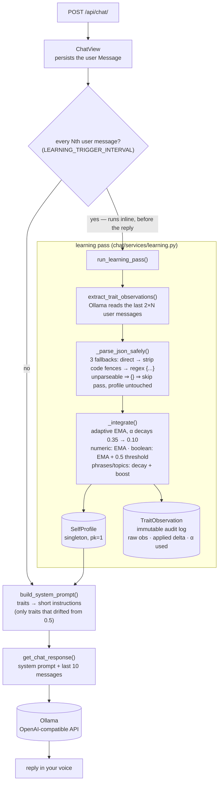

# Persona

A self-learning AI chat system that mimics your personality over time.

Every few messages, Persona analyzes how you write and gradually updates a structured personality profile. A local Ollama model then uses that profile to respond in your voice.

## How it works



### Learning algorithm

The profile stores **structured traits** (not free text) so blending is mathematically well-defined:

| Trait type | Fields | Update rule |
|---|---|---|
| Numeric scores | formality, directness, humor, empathy, verbosity | EMA: `new = α × observed + (1−α) × existing` |
| Boolean patterns | uses_lists, asks_questions, uses_examples | EMA on underlying float score, threshold at 0.5 |
| Phrase set | characteristic_phrases | Decay existing weights, boost observed phrases |
| Topic set | topics | Decay existing weights, boost observed topics |

**Adaptive learning rate (α)** decays as the profile matures:

```
pass  0  →  α = 0.35   (fresh profile — learns fast)
pass  7  →  α = 0.23
pass 15  →  α = 0.10   (mature profile — stable, resistant to noise)
pass 20+ →  α = 0.10   (floor — never fully stops adapting)
```

A single unusual conversation at pass 20 can move a numeric score by at most `0.10 × 1.0 = 0.10` on a 0–1 scale. A boolean trait needs **7 consecutive contradicting observations** to flip in a mature profile.

Worked example — a saturated `asks_questions` (score `1.0`, value `true`) at mature α = 0.10, contradicted every pass. Each pass multiplies the score by `(1 − α) = 0.9`:

```
pass 1 → 0.9000        pass 5 → 0.5905
pass 2 → 0.8100        pass 6 → 0.5314   (still ≥ 0.5 → still true)
pass 3 → 0.7290        pass 7 → 0.4783   (< 0.5 → flips to false)
pass 4 → 0.6561
```

So one contrarian conversation — or even six — cannot rewrite a settled habit. (Pinned by `test_mature_boolean_needs_seven_consecutive_contradictions` in `chat/tests.py`.)

Every learning pass writes an immutable `TraitObservation` row so you can audit exactly what changed and why.

### Known limitation: learning is synchronous

The learning pass runs **inline in the request path** — when a message trips the trigger interval, `ChatView` calls `run_learning_pass()` and waits for a full extra Ollama round-trip before it even starts generating the reply. Every Nth message is therefore noticeably slower than the rest.

This is a deliberate trade-off for local single-user use: no broker, no worker process, and the freshly-updated profile is guaranteed to inform the very reply that triggered it. For anything multi-user or latency-sensitive, the pass belongs on a task queue (Celery, RQ, or `django-q`) instead.

## Requirements

- Python 3.12+
- Poetry
- A running [Ollama](https://ollama.com) instance with a pulled chat model (e.g. `ollama pull gemma3:4b`)

## Setup

```bash
# 1. Clone and install dependencies
git clone <repo>
cd persona
poetry install

# 2. Configure environment
cp .env.example .env
# Open .env and set DJANGO_SECRET_KEY (and OLLAMA_BASE_URL / OLLAMA_MODEL if not using defaults)

# 3. Make sure Ollama is running and the model is pulled
ollama serve            # in a separate terminal, if not already running
ollama pull gemma3:4b   # or whichever model OLLAMA_MODEL points to

# 4. Run migrations
poetry run python manage.py migrate

# 5. Start the server
poetry run python manage.py runserver
```

## Environment variables

| Variable | Default | Description |
|---|---|---|
| `DJANGO_SECRET_KEY` | — | **Required.** Django secret key |
| `OLLAMA_BASE_URL` | `http://localhost:11434/v1` | Ollama OpenAI-compatible endpoint |
| `OLLAMA_MODEL` | `gemma3:4b` | Ollama chat model to use |
| `LEARNING_TRIGGER_INTERVAL` | `5` | Trigger a learning pass every N user messages |
| `DEBUG` | `False` | Django debug mode (set `True` in `.env` for local development) |
| `ALLOWED_HOSTS` | `localhost,127.0.0.1` | Comma-separated allowed hosts |

## API

### POST `/api/chat/`

Send a message. Omit `session_id` to start a new conversation.

**Request**
```json
{
  "message": "what do you think about this architecture?",
  "session_id": null
}
```

**Response**
```json
{
  "session_id": 1,
  "reply": "honestly, it's solid — the separation between..."
}
```

Pass the returned `session_id` in subsequent requests to continue the same conversation.

---

### GET `/api/chat/<session_id>/history/`

Return the full message history for a session.

**Response**
```json
[
  {"id": 1, "role": "user",      "content": "...", "created_at": "..."},
  {"id": 2, "role": "assistant", "content": "...", "created_at": "..."}
]
```

---

### GET `/api/profile/`

Return the current personality profile and its full observation log.

**Response**
```json
{
  "id": 1,
  "update_count": 4,
  "total_messages_processed": 40,
  "traits": {
    "formality":      {"score": 0.28, "observations": 4},
    "directness":     {"score": 0.74, "observations": 4},
    "humor":          {"score": 0.51, "observations": 4},
    "empathy":        {"score": 0.40, "observations": 4},
    "verbosity":      {"score": 0.33, "observations": 4},
    "uses_lists":     {"value": false, "score": 0.21, "observations": 4},
    "asks_questions": {"value": true,  "score": 0.63, "observations": 4},
    "uses_examples":  {"value": false, "score": 0.38, "observations": 4},
    "characteristic_phrases": [
      {"phrase": "honestly", "weight": 0.72},
      {"phrase": "basically", "weight": 0.45}
    ],
    "topics": {
      "software architecture": 0.61,
      "python": 0.43
    }
  },
  "observations": [
    {
      "id": 4,
      "message_count": 10,
      "learning_rate_used": 0.2583,
      "raw_observations": { ... },
      "applied_delta": { "directness": {"from": 0.50, "to": 0.74} },
      "created_at": "2026-04-13T09:00:00Z"
    }
  ]
}
```

## Project structure

```
persona/
├── config/
│   ├── settings.py         # env-driven Django settings
│   └── urls.py             # root URL conf
├── chat/
│   ├── models.py           # ChatSession, Message, SelfProfile, TraitObservation
│   ├── views.py            # ChatView, ChatHistoryView, ProfileView
│   ├── serializers.py      # DRF serializers
│   ├── urls.py             # /api/ routes
│   ├── admin.py            # admin registrations
│   ├── tests.py            # 31 tests — α schedule, EMA, decay, JSON parsing, API endpoints
│   └── services/
│       ├── ollama_client.py   # Ollama (OpenAI-compatible) wrapper + JSON parsing
│       ├── learning.py        # adaptive EMA learning system
│       └── prompt_builder.py  # trait dict → system prompt
├── .env.example
├── manage.py
└── pyproject.toml
```

## Testing

```bash
poetry run python manage.py test
```

31 tests, no Ollama required — every model call is mocked. They pin the parts of the learning system that are easy to break silently: the α decay schedule, EMA blending and clamping, the 7-contradiction boolean flip, phrase/topic decay and pruning, JSON parsing with its three fallbacks (non-object JSON never reaches the learner), learned phrases being sanitized before they enter the system prompt, and the API endpoints (a model failure returns `503` and leaves no orphan user message).

## Admin

```bash
poetry run python manage.py createsuperuser
# then open http://localhost:8000/admin/
```

The admin shows all sessions, messages, the profile trait state, and every `TraitObservation` log entry.
